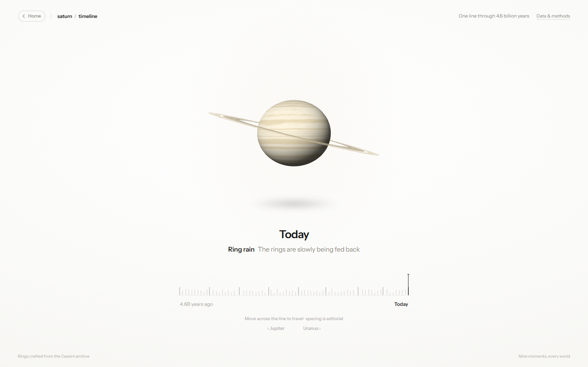
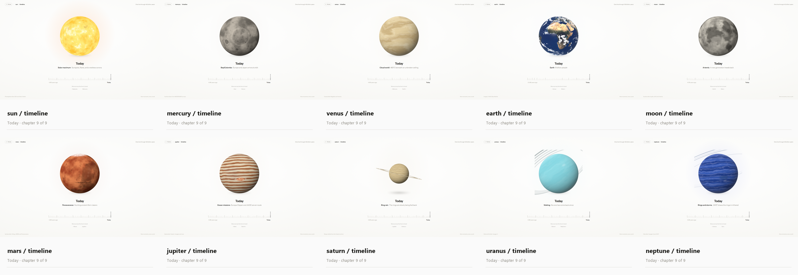

# A solar system of timelines

A small, offline homepage that lines up the Sun, eight planets and the Moon, plus an interactive WebGL timeline — one for **every world**, nine moments each. The homepage takes its cue from a classic planet-lineup illustration; the timeline pages are an independent recreation of the minimalist concept by [@quantapar](https://x.com/quantapar/status/2113562786265756046).






## Run it

No build step. The site is plain HTML, CSS, JavaScript and local assets; it only needs to be served over HTTP (ES modules and textures do not load from `file://`).

```bash
cd earth-timeline
python -m http.server 4173
```

Open <http://127.0.0.1:4173>. Any static server works, for example `npx serve .`.

- `/` is the solar-system homepage.
- `/timeline.html` is the Earth timeline (as before).
- `/timeline.html?planet=mars` — the same timeline treatment for any world: `sun`, `mercury`, `venus`, `earth`, `moon`, `mars`, `jupiter`, `saturn`, `uranus`, `neptune`.
- `&era=N` deep-links a chapter on any world (e.g. `/timeline.html?planet=jupiter&era=4`).
- Legacy `/?era=N` links redirect to `timeline.html?era=N`.

## The homepage

- **Hover a world** — the readout under the line names the world and offers one fact; the CTA retargets to that world's timeline.
- **Click a world** (or focus it and press Enter) — it opens `/timeline.html?planet=…`. The Sun and Moon are links too.
- **Living lineup** — every world turns slowly on its own axis, with its real axial tilt: Uranus rolls on its side, Venus turns backwards, the Moon sits raised beside Earth. Rotation pauses under `prefers-reduced-motion`.
- **Narrow screens** — the lineup becomes a horizontal strip; swipe (or tap) from the Sun out to Neptune.
- **Old links** — `/?era=N` still redirects to the timeline.

## World timelines

Every world gets the Earth treatment on `timeline.html?planet=X`: a centred globe, a bold epoch caption, one chapter line, and a tall black playhead on a nine-moment line ending at *Today*.

- **Scrub** — hover across the line previews a time; click and drag scrubs.
- **Keyboard** — `←`/`→` (or `↑`/`↓`, PageUp/PageDown) step between chapters; `Home` jumps to formation, `End` to today.
- **Globe** — drag horizontally to spin the world. Only Earth uses the Blue Marble textures; the rest are procedural GLSL (the same shaders as the homepage), dressed per era — the Sun from protostar to solar maximum, the Moon from the Theia impact to Artemis, Mercury cooling from lava-cracked rock to the Caloris basin, Venus's magma ocean giving way to a possible ocean world, Mars gaining Hellas and rivers before drying into the canyon-cut desert we see today, Jupiter's storm appearing in 1665 and carrying Shoemaker–Levy 9's scars in 1994, Saturn's rings puzzling Galileo in 1610, Uranus's calm methane disk and dark rings found by accident in 1977, and Neptune's Great Dark Spot arriving in 1989 and vanishing in 1994, with JWST drawing its rings today.
- **Surface accuracy** — the shared shaders model maria, crisp craters and ejecta rays on rocky worlds, giant impact basins, Mercury's lobate scarps and bright hollows, the Valles Marineris gash and Tharsis volcanoes on Mars, transient lava fields and ancient Martian water; zonal flow and methane cirrus on the ice giants, including bright convective ovals and polar hoods; Venus's surface showing through a thinner early cloud deck; turbulent belts with a sheared red spot and comet scars on Jupiter; granulation and sunspots on the Sun; and three ring styles — Saturn's C/B/A structure with the Cassini division and Encke gap, Uranus's narrow charcoal rings, and Neptune's sparse arcs.
- **World switcher** — every timeline, Earth included, carries `‹ prev | next ›` links under the hint; they hop between worlds in orbital order (wrapping Neptune → Sun → Mercury).
- **Masthead** — a top-left `‹ Home` pill sits before the wordmark. Both it and the world wordmark (`mars / timeline`) return to the solar system, and the wordmark names the world you're in.
- **Reduced motion** — respected everywhere, as on Earth.

## How it is made

- **Three.js** is vendored locally (`assets/three.module.js`), no CDN or package manager.
- **Homepage** — one orthographic WebGL canvas behind a line of DOM hit targets; CSS owns layout and the spheres are drawn to match. Each world gets its own tilt group and spin rate. Shared world shaders live in `planets.js`.
- **Timeline** — Earth keeps its texture pipeline (day/specular/Pangaea/clouds + era mixing). World modes rebuild the same rig from `planet-eras.js`: each of the nine chapters carries a look (colors, cratering, maria, caps, basins, lava, water, scarps, canyons, volcanoes, bands, storms, bright clouds, polar hoods, comet scars, sunspots, ring alpha, spin, halo) that the render loop blends between. Saturn, Uranus and Neptune draw the shared ring shader with an era-driven alpha, opening angle and style.
- The timeline, caption transitions, slider semantics and responsive layout are plain DOM and CSS.
- The Pangaea texture is generated by `tools/gen_pangaea.py` (NumPy + OpenCV). It is an artistic reconstruction.
- Everything runs offline after the page loads.

## Project layout

```
index.html                 solar-system homepage and legacy deep-link redirect
home.css                   homepage layout, strip and responsive rules
home.js                    homepage scene, hover readout, axial motion, click-through
planets.js                 shared procedural world shaders (homepage + timelines)
planet-eras.js             nine chapters and looks per world
timeline.html              timeline markup (all worlds), import map
styles.css                 timeline layout, scrubber, world switcher, orbs
main.js                    era data, shaders, input, render loop, world mode
assets/                    local Three.js, textures and font
shots/                     review screenshots
reference/                 original reference video and frames
tools/gen_pangaea.py       regenerate assets/pangaea.png
tools/shoot.py             CDP screenshot helper
tools/contact_sheet.py     rebuild shots/planet_timelines.png
tools/test_ui.py           interaction smoke test
```

`shoot.py` and `test_ui.py` expect the local server above and a Chrome instance with remote debugging on port 9334 (`CDP_PORT` overrides it). Run that instance with `--force-device-scale-factor=1`: on a high-DPI Windows desktop, Chrome's default fractional scale can leave ghosted text in headless screenshots.

```bash
chrome --headless=new --remote-debugging-port=9334 --force-device-scale-factor=1 \
  --user-data-dir="$TEMP/chrome-shots" --window-size=1440,900 about:blank
```

`shoot.py` accepts era numbers, `home`, `home-mobile`, `planets` (every world today), a single world (`planet-saturn`), a world chapter (`planet-neptune-5`), or `all`. `test_ui.py` checks homepage hover/CTA linking, axial rotation, real tilts and reduced-motion pausing, mobile scrolling; the legacy redirect; Earth deep links, keyboard, hover, pointer and touch scrubbing, globe dragging and mobile layout; then world timelines — Mars/Jupiter deep links and keysteps, Saturn's rings and era-driven opening, the world switcher (Earth's neighbours included), the Sun and Moon routes, mobile/reduced-motion routes, homepage click-through for planets, the Sun and the Moon, era-specific surfaces (Mercury's lava and Caloris, Venus's magma ocean and seas, Mars's Hellas and rivers, Jupiter's 1994 scars, the ice giants' bright clouds), and the top-left home control.

## Credits

- Globe imagery: NASA Blue Marble, via the Three.js example textures.
- [Three.js](https://threejs.org), MIT licensed.
- Instrument Sans, SIL Open Font License 1.1.
- Original timeline concept by [@quantapar](https://x.com/quantapar/status/2113562786265756046). This is an independent, non-commercial recreation.
