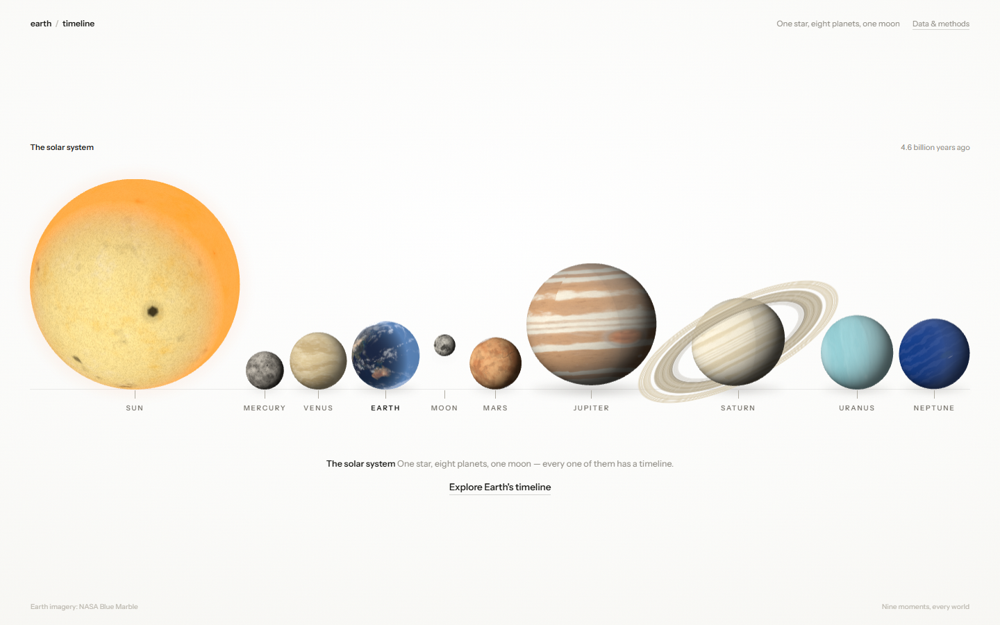
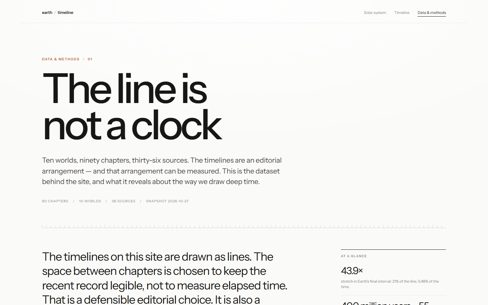

# The line is not a clock

**A solar-system timeline — and an audit of its own editorial choices.**

[](https://github.com/ZoroSec/solar-system-timelines/actions/workflows/ci.yml)
[](LICENSE)
[](data/LICENSE)

[Live site](https://zorosec.github.io/solar-system-timelines/) ·
[Data story](https://zorosec.github.io/solar-system-timelines/data.html) ·
[Dataset dictionary](data/README.md) ·
[Audit report](reports/time-axis-audit.md)



The site gives ten worlds nine chapters each and draws them as lines. The
spacing is editorial: it keeps the recent record legible instead of pretending
that a 13.8-billion-year history can share a linear axis with a decade of
spacecraft observations.

That is a defensible design choice, but it is still a transformation of data.
This repository publishes both layers — the interactive site and the table
behind it — and measures what the layout does to time.



## The question

A timeline is a chart. If its marks are placed for legibility rather than
duration, the chart has a distortion, and the distortion can be quantified.

The project asks four questions of its own sample:

1. How much line does each interval receive, compared with the time it represents?
2. Where is the sample silent, and how large are those silences relative to each world's span?
3. Do deep time and the dated record behave like one process or two?
4. Which claims are observations, which are inferences or models, and where do the cited sources disagree?

The answer is not a single score. It is a small, sourced dataset with enough
structure to make the editorial choice visible.

## What the audit found

- **Earth's recent end is stretched 43.9×.** The final 21% of Earth's line —
  *Chicxulub* to today — represents 0.48% of its 13.8-billion-year span. The
  first interval gets 7.5% of the line for 66.67% of the time. The final
  interval is **399×** more expanded than the first.
- **The sample has two tempos.** The median gap between consecutive deep-time
  chapters is **400 million years**; the median gap between consecutive dated
  observations is **55 years**. The medians pool like with like: 36 deep/deep
  and 25 dated/dated intervals, with the 19 boundary intervals excluded. A
  single average would describe neither record.
- **The largest silence depends on the denominator.** Saturn's largest gap
  covers **93%** of its own span. Earth's gap is the longest in absolute years
  — **9.2 billion years** between the Big Bang and the protoplanet — but covers
  67% of its span. The data story charts the normalized share.
- **The dated record is an observation history, not a uniform sample.** **71%**
  of dated chapters fall in the 1600s and 1900s. Nine of ten worlds have a
  dated chapter; **Earth has none** — its line runs from deep time straight to
  Today.

These numbers are generated from the CSV by `analysis/audit.py`. They are not
typed into the charts by hand.

## The dataset

`data/events.csv` is the canonical table: **90 rows**, one per chapter, with
**36 sources**. Each row carries:

| Field group | What it records |
|---|---|
| Identity | `event_id`, `world`, `chapter` |
| Position | `layout_at` (editorial, 0–1), `time_label`, `years_ago` |
| Uncertainty | `years_ago_low` / `years_ago_high`, `source_note` |
| Classification | `time_kind`, `event_class`, `evidence`, `status` |
| Provenance | `source_id`, `as_of` |

The companion tables are `data/worlds.csv` (ten world records) and
`data/sources.csv` (citations with publisher, URL, kind, and notes). The
[data dictionary](data/README.md) covers units, conventions, and caveats.

A few deliberate rules:

- **Ages are years before 2026.** `4.6 billion years ago` is
  `4,600,000,000`; `years_ago = 0` means Today.
- **`layout_at` is not time.** It is an editorial coordinate, monotonic within
  a world, and must never be used to estimate elapsed time.
- **Ranges are exceptions, not decoration.** A range is recorded only where
  cited sources genuinely disagree. A blank range means “no range assigned,”
  not certainty.
- **Evidence is graded.** `observed`, `inferred`, `modeled`, `hypothesis`, and
  `state` are different kinds of claim. “Today” is a snapshot at **2026-10-27**,
  not a live feed.

## Method

```text
data/events.csv ──┐
data/worlds.csv ──┼─> analysis/audit.py ─> data/analysis.json
data/sources.csv ─┘                    └─> reports/time-axis-audit.md
                                                │
                                                ▼
                                      data.html / data.js
                                      (SVG charts + table)
```

`analysis/audit.py` validates the three tables, derives the intervals, gap
statistics, century counts, and world records, then writes the committed
artifacts. The `generated` field is pinned to the dataset snapshot
(`max(as_of)`), not the machine's clock, so `--check` is deterministic.

The presentation layer is separate. `data/js-events.json` is exported from the
authored chapter copy and committed as a parity artifact; CI fails if it drifts
from `planet-eras.js` / `earth-eras.js`. The browser then reads the published
JSON and CSV directly — no build step, no chart library, no WebGL, no animation
loop.

Validation is part of the deliverable:

```bash
node tools/export_events.mjs --check   # presentation/dataset parity
python analysis/audit.py --check       # generated analysis is current
python -m pytest -q                    # schema, parity, analysis, page tests
python tools/check_sources.py          # optional network check of all 36 URLs
```

GitHub Actions runs the first three on every push and pull request. The source
check is separate because external publishers rate-limit and block bots; it
reports 401/403/429 responses as *blocked*, not broken. The browser regression
suite (`tools/test_ui.py`) separately checks the homepage, every world timeline,
and the data page at desktop and mobile widths.

## Why this is a data project

There is no model here, and that is intentional. With nine curated chapters per
world, a predictive claim would be theater. The work that makes the sample
useful is the unglamorous part:

- a typed, validated table with stable keys;
- numeric ages separated from layout coordinates;
- explicit evidence grades and source provenance;
- uncertainty recorded only where the sources disagree;
- a reproducible pipeline whose committed outputs are checked in CI;
- a public account of what the sample cannot support.

The result is a portfolio-scale project about **measurement and disclosure**,
not a dashboard with a decorative regression line.

## Corrections made while building the dataset

The audit surfaced five presentation claims that did not match the cited
record. The CSV, the site copy, and the generated analysis now agree:

- **Sun, 4.1 Ga:** “main sequence” replaces the ambiguous “steady state.”
- **Saturn, 1655:** Titan was discovered in 1655; the ring interpretation
  followed in 1659.
- **Moon, 1972:** Apollo 17 returned the last lunar samples, not Apollo 11.
- **Mercury, Today:** BepiColombo orbit insertion is due in November 2026.
- **Earth, Today:** population is recorded as 8.2 billion (UN WPP 2024).

The source URLs were checked on 2026-10-27. Two NASA pages had moved and were
replaced, and a slow NSSDC record was swapped for NASA's Venus mission
timeline. Publisher 403 responses from some journal sites are bot blocks, not
broken citations.

## Limitations

- The ninety chapters are a **curated sample**, chosen to tell a coherent story.
  They are not a random or complete inventory of events.
- A gap is a property of the sample. It is not evidence that nothing happened
  during that interval.
- Nine chapters per world is a format constraint, not a finding. The equal
  counts carry no information about the worlds.
- “Today” is a snapshot at **2026-10-27**. Planned missions are marked as
  planned, not as completed.
- The globes are illustrations. Only Earth uses spacecraft imagery; the other
  surfaces are procedural and not spatially registered to the real worlds.
- The dated record is a history of observation. Its clusters reflect
  telescopes, spacecraft, and access to instruments — not the underlying rate
  of events.

## The site

The public site is plain HTML, CSS, JavaScript, and local assets. It runs
offline after the page loads; Three.js is vendored, with no CDN or package
manager.

- `/` — the solar-system homepage. Hover a world for a fact, click it to open
  its timeline.
- `/timeline.html` — Earth's timeline. `?planet=` selects any of the ten
  worlds; `&era=N` deep-links a chapter.
- `/data.html` — the data story, four SVG charts, the filterable 90-row table,
  downloads, methods, and limitations.
- Legacy `/?era=N` links redirect to `timeline.html?era=N`.

The timeline supports pointer scrubbing, keyboard stepping, a draggable globe,
a world switcher, and reduced-motion preferences. Every timeline states that
its spacing is editorial and not to scale.

## Run it locally

```bash
python -m http.server 4173
```

Open <http://127.0.0.1:4173>. Any static server works; ES modules and textures
do not load from `file://`.

For the data checks:

```bash
python -m pip install -r requirements.txt
node tools/export_events.mjs --check
python analysis/audit.py --check
python -m pytest -q
```

Regenerate the committed artifacts after changing a CSV or a chapter:

```bash
node tools/export_events.mjs data/js-events.json
python analysis/audit.py
python -m pytest -q
```

The browser suite needs the local server plus Chrome with remote debugging:

```bash
chrome --headless=new --remote-debugging-port=9334 --force-device-scale-factor=1 \
  --user-data-dir="$TEMP/chrome-shots" --window-size=1440,900 about:blank
python tools/test_ui.py
```

## Project layout

```text
index.html                 solar-system homepage and legacy redirect
timeline.html              timeline markup for all ten worlds
data.html                  data story: charts, table, methods, limits
home.css / styles.css      homepage and timeline styling
data.css / data.js         data-page styling, SVG charts, table filters
planet-eras.js             authored chapters and looks for nine worlds
earth-eras.js              authored Earth chapters
main.js / home.js          timeline and homepage renderers
planets.js                 shared procedural world shaders
assets/                    local Three.js, textures and font
data/                      canonical CSV tables and generated analysis
analysis/audit.py          validation, metrics, report generation
reports/                   generated audit report
tests/                     dataset, parity, analysis and page tests
tools/export_events.mjs    presentation-to-dataset parity export
tools/check_sources.py     network check for all source URLs
tools/test_ui.py           Chrome DevTools regression suite
tools/shoot.py             screenshot helper
.github/workflows/ci.yml   parity, analysis and pytest checks
```

## Credits and license

- Globe imagery: NASA Blue Marble. Planetary facts and mission records:
  the sources in `data/sources.csv`, primarily NASA and ESA.
- [Three.js](https://threejs.org), MIT licensed. Instrument Sans, SIL Open Font
  License 1.1.
- Original timeline concept by
  [@quantapar](https://x.com/quantapar/status/2113562786265756046). This is an
  independent, non-commercial recreation.

The code is MIT licensed (see `LICENSE`). The data tables in `data/` are
released under [CC BY 4.0](https://creativecommons.org/licenses/by/4.0/); cite
this repository and the underlying sources.
